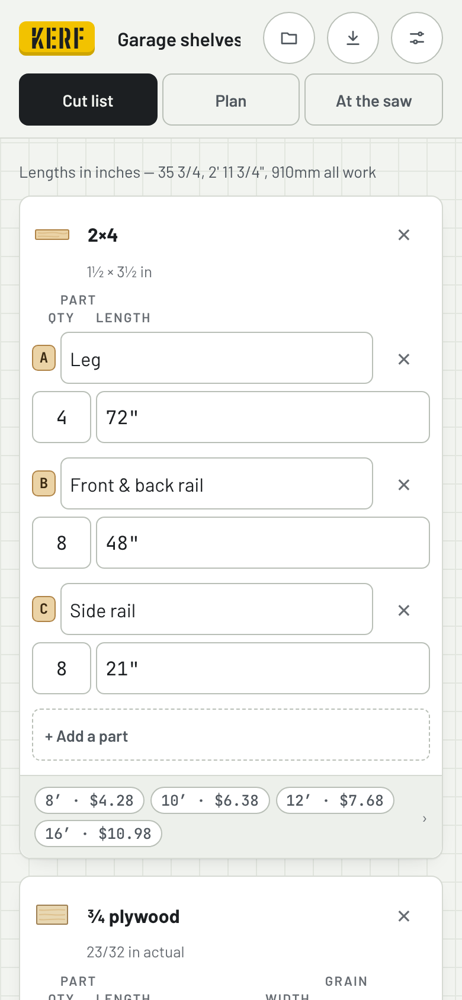
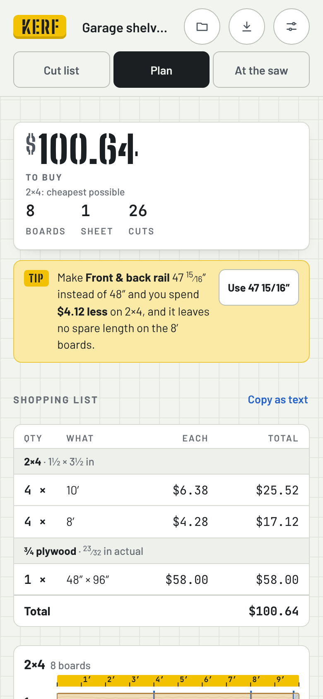
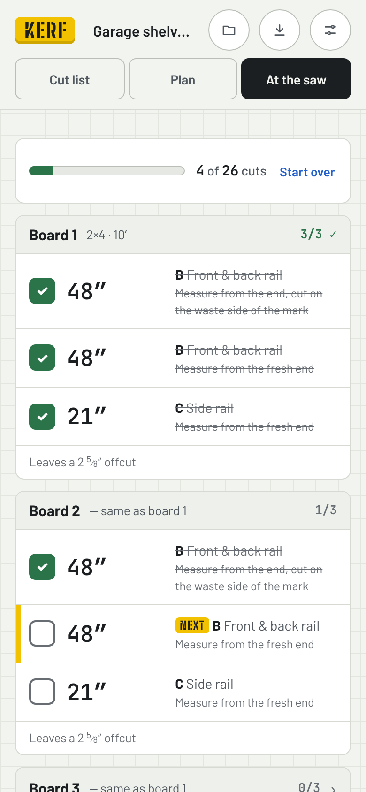

# Kerf

**Use it: [kerf.junkdrawer.works](https://kerf.junkdrawer.works/)**

**A cut-list optimizer for lumber and plywood.** List the parts a project needs; Kerf works out the cheapest boards and sheets to buy, draws how to cut each one, and gives you a checklist to work through at the saw. It plans construction lumber and sheet goods bought by the piece, a 2×4 or a sheet of plywood at a price each, not hardwood sold by the board foot. It installs as an app (from the browser's menu, or Share → Add to Home Screen on an iPhone) and works offline once it has loaded.

<p align="center">
  
  &nbsp;
  
  &nbsp;
  
</p>

## How it works

- **Cut list.** Group parts by material: 2×4s, 1×6s, ¾ plywood, anything. Each material lists the sizes you can buy and what they cost. Each part has a letter, and the letters run through the whole project, material after material (the example's 2×4 parts are A to C, and its plywood shelf D), so a letter names one part in the cut list, the drawings, at the saw and on the shop PDF. Lengths can be typed the way a tape reads: `35 3/4`, `35-3/4`, `2' 11 3/4"`, `¾`, or `910mm`; `2,440` is 2440 mm, while a comma before one or two digits is a decimal point (`2,5` is 2.5 mm). A length stays in its field as typed, to the 32nd of an inch or the tenth of a millimetre; the plan, the saw and the drawings work to the sixteenth and the half millimetre. The page can also work in millimetres throughout. On a phone or tablet an inch length takes the number pad, and while one has focus a row of keys above the keyboard types ⅛ ¼ ⅜ ½ ⅝ ¾ ⅞, ′ and ″ (`35¾` reads as 35 3/4, and a fraction typed after a length's inch mark goes before it); its last key, **abc**, swaps that field to the letter keyboard and back, for a sixteenth typed as `15/16`. Rows copied from a spreadsheet (Sheets, Excel, Numbers) and pasted into a part's name come in as parts: name, count, length and width, in that order, or in the order a first row naming its columns gives (Part, Qty, Length, Width), and a count in the first column is taken as one. They go after the part pasted into, or in its place while it's blank, and the toast has **Undo**; one line with no tab pastes as a name. A count can be up to 9999, but Kerf plans at most 500 of one board part and 300 of one sheet part: past that, the count stays as typed, and the cut list and the plan say how many are left out, so the part can be split into two rows.
- **Plan.** The total to spend, a shopping list you can copy as text, and a diagram of every board and sheet. Under the shopping list, the offcuts worth keeping (at least **Keep offcuts over** long, and that wide too for a piece of sheet) are gathered on one line, alike ones counted together: *“Offcuts worth keeping: 2 × 23 7/8″ 2×4, 1 × 96″ × 24 1/8″ ¾ plywood”*. Under the total, **Cheapest possible** says the board plan is proved the cheapest there is (the exact search below finished, with no part left out); with sheets as well, it names the board materials it holds for ("2×4: cheapest possible"). Sheet plans aren't proved, and nothing is said for them. The diagrams show the parts, the saw kerf between them, and the offcut left over. Boards cut alike (the same size, the same parts in the same order) are drawn once, a row to each run of them: the example's eight 2×4s are two rows, **1–4** over *10′ ×4* and **5–8** over *8′ ×4*, each with a second board showing behind it. On a tablet or a laptop the diagrams name each part where there's room, *B Front & back rail 48″*, cutting a long name short with … to fit, and a sheet part with room for three lines has its name between its letter and its size. On a phone they keep to letters, which the list under each diagram names.
- **Tips.** After each change Kerf checks whether shaving a part by a sixteenth or two (or a few mm) would let you buy less wood. It says so — *“Make the rail 47 15/16″ instead of 48″ and you spend $4.12 less on 2×4”* — with a button to apply it, and the saving it names is what applying it saves. When the shaved part then fills its boards to within a sixteenth, the tip says so: *“…, and it leaves no spare length on the 8′ boards”*, since the plan then needs every inch of them. A tip has to beat a plan that can't do as well without it: for boards Kerf offers tips only when its plan is the cheapest possible (the exact search below finished), and for sheets only when the parts as they are, packed the way the shaved plan was, cost more. It checks while the page is idle, so typing never waits for it, and a tip goes as soon as it's applied or its part changes. A material of more than 16 parts, 60 sheet pieces or 500 board pieces is too big to check quickly and gets no tips.
- **Offcuts you already have** are used whenever they save buying, for free, and never more of them than you say you have. Setting a size you buy to **Have 1** (or any count) keeps that size to buy as well, so Kerf uses yours first and buys more if it needs them. If parts fit only on wood you have and it runs out, Kerf plans what fits on it and leaves the rest out: the plan and the cut list name the parts left out and how many, and ask for a size to buy. No part is left out that would fit in the room the plan leaves.
- **Ripping boards.** A board material can have a width (**Board width**, among its sizes; the presets have their actual widths, a 2×4 3½″). With one, each part shows a width too: left blank it's the whole board, and a narrower one (face-frame stiles from a 1×6) is ripped from the board along its length. A board with a part ripped narrower is planned the way sheets are, as wide as the board and grain along its length, but it's still a board: **Board 1**, drawn deeper than to scale so its strips can be read, with steps such as *“Crosscut the board at 30″”* and *“Rip the 65 7/8″ × 5 1/2″ piece at 1 1/2″”*, and with end trim, a first step to square up both ends. A part wider than the board says so. Take the width away and the parts' widths hide and are ignored.
- **Grain.** Sheet parts can be locked so the grain runs along their length; unlocked parts may be turned to fit better. A sheet's Length is the way its grain runs too (a 4×8 is 8′ long and 4′ wide), and Kerf plans and draws each sheet the way round it was typed.
- **At the saw.** Each board and sheet becomes a checklist in cutting order, with where to measure from. The screen stays on while the checklist is showing (where the browser allows it). The next cut to make is marked, and opening Kerf at the saw goes straight to it. The bar with the count stays in sight at the top as the cuts scroll by, each board's heading under it, and its **Next cut** goes to the next cut from anywhere in the list. A part that comes off without a cut (the last of a board, which you're asked to measure in case the board ran long, or a whole board or sheet) is noted but not counted, so the saw counts the same cuts as the plan. A sheet part that is exactly the piece a cut leaves is named with that cut: "Rip the full sheet at 24″ → A Left side · what’s left is B Right side". A rip wider than what it leaves past the blade gives a second fence setting, for a saw whose fence won't reach that far: a 31 1/4″ rip off a 48″ sheet adds *“or set the fence at 16 5/8″ — the part is the piece past the blade”*. It isn't offered for less than an inch, which would leave a thin strip trapped between the blade and the fence. A sheet's card is headed with its material, *“¾ plywood · Sheet 1”*, and starts with the sheet's drawing, its next cut a yellow line and number (none while the factory edges are still to trim) and the cuts ticked faded, and each cut gives its number in the drawing; a tap on **Drawing** folds it away. Boards keep to text. Every board keeps its own place and its own ticks, but a board cut like one before it is folded, *“Board 2 — same as board 1”*, and opens on a tap; it opens by itself once one of its cuts is ticked or it holds the next cut, so the next cut always shows. A board or sheet whose cuts are all ticked folds to its heading, *“Board 1 2×4 · 10′ 3/3 ✓”*, so finished ones don't push the next cut screens down; a tap opens it. Ticking the last cut turns the bar green ("All 26 cuts done"), shows the offcuts worth keeping again under it, and says the project is ready to put together; a reload of a finished job just shows the green bar. Ticks are saved as you go, and stay on the cut they were made on: each material keeps its own, so editing the plywood leaves the 2×4 ticks alone, and renaming a part keeps them. When an edit changes a material's plan, its ticks clear and a notice says how many; if the plan comes back (a count changed and changed back), so do they. **Start over** clears every tick, and a part's ✕ removes it at once; both show a toast with **Undo** for a few seconds (as long as the pointer or keyboard focus is on it), which puts the part back where it was, with its plan and its ticks.
- **Notes.** At the foot of the cut list, a box for what Kerf doesn't plan: the hardware, glue-ups, the finish, a spare board. Up to 2,000 characters, kept with the project, in its links and files, and printed on the shop PDF. Typing them never plans anything again.
- **Shop PDF.** A printable sheet with the shopping list (and the offcuts worth keeping and the project's notes under it) and every diagram, drawn to read in black and white: parts white, offcuts and what's left of a sheet hatched and labelled with their size. Boards cut alike are drawn once, and parts are named where they fit, as in the plan on a wide screen. It's the checklist at the saw on paper too, with a box to tick before every cut the saw counts: under each row of boards come their cuts in order, each with its measurement and part and a box for every board in the row (numbered over them, or one box and the count for more than 16), and each sheet's numbered steps start with a box, its trims first.
- **Projects** are kept in the browser's local storage, with no account and no server. To move one to another device, save it as a file or copy it as text, then open or paste it there. Deleting one takes two taps, and the toast after it has **Undo** for a few seconds, which brings the project back where it was in the list, ticks and all. With Kerf open in two windows, a project added, changed or deleted in one shows up in the other, and so does one brought back. If the browser won't keep them (its storage is full, or cookies are blocked), a strip under the top bar says so until a save works, with a button to save the project as a file.

Settings per project: saw kerf (⅛″ by default; a thin-kerf 3/32″ or 2.2 mm shows as typed, there and on the shop PDF), trimming each board end square, trimming sheet edges (that much comes off each factory edge of a sheet before any other cut: each sheet is planned that much smaller all round, its steps start with **Trim the factory edges**, and a part that fits only with the edges left on says so), the smallest offcut worth keeping (an offcut that shows as that length counts, though the sums leave it a hair short), and the currency sign. The preset prices are examples, and a material still on them says *Example prices — tap to set yours* under its sizes until a price is changed. Kerf remembers the last prices you set for each kind on the Add material list (a 2×4, ¾ plywood), size by size, in this browser (under `kerf.prices` in local storage, apart from the projects), and the next one you add starts at them; a material is that kind by its name.

## How it plans

**Boards** are a cutting-stock problem: fit pieces onto stock lengths as cheaply as possible, with a kerf between pieces.

1. Kerf first tries an exact search. Some board must hold the longest piece left, and it can take every other piece that still fits: moving a piece onto it from another board never costs more. So Kerf branches only on those boards, remembering the cheapest way to finish from each set of pieces left. For the cut lists people actually make — a handful of distinct lengths — this finishes in milliseconds and the answer is the cheapest possible.
2. When a job is too big for that search, Kerf falls back to heuristics:
   - a greedy fill by price per inch of parts;
   - first fit, longest piece first, on each size to buy, the way it's done by hand: the plan never costs more than that;
   - a look-ahead that tries every first board and finishes greedily;
   - randomized restarts.
3. Each board then moves to the cheapest stock length its pieces still fit on.

A board with a part ripped narrower than it is planned as sheets are, below: each size is a sheet as long as the board and as wide as it, the parts locked to the grain, and with end trim only the ends trimmed. The exact search doesn't apply there, so such a plan is never called the cheapest possible and gets no tips.

**Sheets** are cut with guillotine cuts only — every cut runs edge to edge across the piece, which is what a table saw or track saw can do. Kerf packs parts into free rectangles and tries:

- several part orders, fit rules and split rules;
- strip layouts, the way a shop breaks down a sheet: rip it into strips (or crosscut it into panels), crosscut each strip, and rip the parts stacked in it, taking for each sheet the size that holds the most for its price;
- shuffled orders;
- repacking each sheet's parts onto smaller sheet sizes when that costs less (two half sheets can beat one full one).

Of layouts that cost the same, it takes the one with fewer sheets, then the one kinder to a table saw: starting with a rip rather than a crosscut across a whole sheet, with as few different rip widths (fence settings) as it can. Then the one that leaves the biggest piece.

The layout's cut tree becomes the numbered rip and crosscut steps, in the order to make them: each once the piece it's made on exists, cuts at the same fence setting (or crosscuts at the same length) one after another, and otherwise the piece in your hands finished before the next. Sheet packing is a heuristic, not a proof: it is good, not guaranteed optimal.

Every search stops after a set number of steps, not after a set time, so a project gets the same plan on a fast laptop and a slow phone, and the ticks at the saw stay put. Sheets take the longest: a ¾ plywood job of up to 50 pieces takes about a tenth of a second on a laptop, and about half a second (at most three quarters) on a phone five times slower.

Each material's plan is kept until something it was worked out from changes: its sizes, prices and offcuts on hand, its parts' sizes, counts and grain, the kerf, and the end trim for boards or the units a sheet's steps are written in. So renaming a part, changing the currency or editing another material doesn't plan it again, and the plan redraws at once. While you type, Kerf plans again once you pause: after a fifth of a second, or about two thirds of a second for a material whose last plan took longer than 80 ms, so a slow phone isn't held up planning `3`, `30` and `30 1` on the way to `30 1/4`. Enter, or moving on from a length, plans at once. That changes only when Kerf plans, never what it plans.

## Planning a build with Claude

`skill/kerf-planner/` is a skill for Claude. It helps you work out a design in conversation, derives an exact cut list from actual lumber sizes and the joinery, and hands the result to Kerf as a link and a project file, with what Kerf doesn't plan (hardware, glue-ups, the finish) in its notes. To use it, zip the `kerf-planner` folder and upload it as a skill in claude.ai; it needs code execution turned on. Its script, `scripts/make_kerf.py`, also runs on its own:

```
python3 skill/kerf-planner/scripts/make_kerf.py plan.json
```

## Opening a project from a link

A link like `https://kerf.junkdrawer.works/#k1z…` carries a whole project in the part after `#`, so it never reaches a server. Opening one shows what's in it and asks before adding it as a new project. It never replaces one you have, and opening the same project again, whether by link, file or pasted text, offers your existing copy (Projects shows the time a project was changed today, so copies can be told apart). A link pasted into the box under **Projects** opens the same way, which helps on an iPhone: there a tapped link opens in Safari, not in Kerf on the home screen, and the two keep their projects apart. So a link opened in Safari on an iPhone or iPad says so, with a **Copy link** button for pasting it into Kerf on the home screen. A link still opens with a full stop or bracket picked up from the sentence around it, wrapped across lines, or rewritten by Outlook's Safe Links; one that holds no project says so.

The format is the project JSON, compressed with raw DEFLATE and base64url-encoded; `#k1j…` is the same without compression. `#project=` followed by URL-encoded JSON also works, for writing a link by hand.

## Project files

A saved project is JSON: `{"kerf": 1, "project": {…}}`. Lengths are stored in inches whatever the display units. Opening a file, or pasting a project's text into Projects, shows what's in it and asks first, the way a link does. It keeps only fields Kerf understands and clamps the numbers, so a hand-edited file can't break the page. It opens up to 100 materials, 50 sizes and 1000 parts in each, names up to 200 characters, notes up to 2,000, and lengths up to 1200″ (100 ft), well past what the cut list makes, so whatever Kerf saves opens again whole; past those limits it keeps the first and says what it left out before adding anything. A part asking for more than Kerf plans of one part (500 of a board part, 300 of a sheet part) says so where it opens, and keeps its count. A material with `"examplePrices": true` is still on Kerf's example prices, and says so in the cut list. A board material's `wid` is its board's width, and a board part's `wid` a part ripped narrower (none, or 0, is the whole board). A part with no count comes in as one, a sheet part with no grain as grain-locked, and a material with parts but no size to buy gets the size **Other board** or **Other sheet** starts with, with a note to check it. Something with nothing Kerf can read in it says so instead of adding an empty project.

In the browser, projects are kept under `kerf.v1` in local storage, with the number of the format they're saved in, `v` (now 1), raised whenever that shape changes. A page that finds a higher number, saved by a newer Kerf in another window, doesn't read it, take it in or write over it: it stops saving and asks for a reload. If that's ever damaged, by a browser add-on or a hand edit, Kerf repairs what it can, keeps the text as it was under `kerf.v1.bad`, and says so in a strip under the top bar, with a button to save that copy as a file (`kerf-damaged.txt`).

## Running it

It's a static site: plain HTML, CSS and JavaScript in one page, with no build step.

```sh
npx serve .                   # or any static file server, then open the printed address
npm test                      # checks the solver against brute force, then seeded random jobs and edits, then uses the real page in Chromium (needs Playwright)
node tools/screenshots.mjs    # redraws docs/*.png and og.png
node tools/make-icons.mjs     # redraws the PNG icons from icon.svg and the two in tools/
```

To put it online with GitHub Pages: **Settings → Pages → Build and deployment → Deploy from a branch**, then pick `main` and `/ (root)`.

### Tests

`npm test` runs three suites. `test/solver.test.cjs` needs no dependencies: it reads the solver straight out of `index.html` and checks:

- **Parsing:** lengths in each format parse to the right value, and read back to the 32nd or the tenth of a millimetre in a field. The kerf-planner skill's `make_kerf.py` reads every one of them to the same inches (skipped, with a note, where there's no `python3`).
- **Boards:** the example project costs the known optimum, several hundred random jobs match a brute-force search, and 150 bigger ones (and a 24-piece job that used to cost $1.22 more) never cost more than first fit, longest piece first, and list boards cut alike one after another, so they're drawn once. The random jobs include offcuts on hand, end trim and two kerf widths. Boards on hand that run short are reported, not left to crash: the parts that fit are planned and the rest said to be left out. In 160 seeded jobs, boards and sheets, where what's on hand runs out, every part is planned or said to be left out, only parts no size to buy holds are left out, none of them would fit in the room the plan leaves, and the parts that fit, planned on their own, come out the same. More than 500 of one part is reported, not quietly left out.
- **Big jobs:** a 90-piece job finishes quickly, and 800 pieces in 16 lengths don't run the search out of stack.
- **Sheets:** in 200 random jobs, every part is on its sheet at the right size, no two parts overlap once the kerf is counted, and grain-locked parts are never turned. Every part on a sheet is named by exactly one step (the cut that gives it, the cut that leaves it, or the note that it is the whole sheet), in 200 more seeded jobs full of parts that fill what a cut leaves exactly. More than 300 of one part is reported, not quietly left out. One sheet on hand and the same size to buy plan one free and one bought; with none to buy, the sides that fit on the sheet on hand are planned and the rest left out. Two ¾ plywood jobs that cost more when the shuffle had half the work come out as cheap as the old time limit found them, and two that only strip layouts fit on fewer sheets come out that way, packed again the same. Of layouts that cost the same, the example's shelves, two cabinet sides and six 12″ shelves start with a rip of the full sheet and use one fence setting. A sheet's cuts come in an order that can be made, the strips at one fence setting ripped one after another, in 150 seeded jobs too.
- **Boards ripped into narrower parts:** a face frame from a 1×6 costs one 8′ board, with a rip at 1 1/2″; in 107 seeded jobs, some with end trim, every part is on its board at its size (a part with no width the board's), never turned, inside the trimmed ends and clear of the others by the kerf; a part wider than the board is said not to fit.
- **Tips:** the example's tip saves what it says, and notes that it leaves no spare length on the 8′ boards (three slats with ⅛″ to spare get no such note); a 40-piece workbench, too big for the exact search, gets no tip promising a total its parts as they are can already reach; and two plywood seats free to turn get tips that save exactly what they say.
- **Same plan anywhere:** with the clock slowed to a crawl, the example, a bigger board job, a plywood cabinet and face frames ripped from 1×6s come out exactly as they do at full speed.
- **Trimming sheet edges:** two 96″ sides no longer fit once ¼″ comes off each edge, the example's shelves fit with ⅛″ off but not ¼″, and every part and cut stays inside the trimmed edges.
- **Offcuts worth keeping:** a 300 mm offcut with Keep offcuts over at 300 mm, and an 11 31/32″ one shown as 12″ with it at 12″, are worth keeping at the saw; a 299 mm one isn't.
- **Ticks stay on their cuts:** over 400 seeded random edits, wherever an edit keeps a material's tick key, every cut the saw shows for it reads as before (its letters read as they would in its own material, since a part added to another material moves them along); switching units keeps the keys. Letters run through the project, 2×4 A–C, ply D and 1×2 E–F, and a part added to the 2×4 moves the ply's on to E and keeps its tick key.
- **Plans kept between edits:** in a project with a board and a sheet material, each of 37 edits plans again only the materials it changes (nothing for a rename, only the plywood for a part's grain or the sheet edges' trim, both for the kerf), and the plan Kerf keeps is the one a fresh start finds, down to the sizes and parts it points at, also when another window's save brings a new copy of the project.

`test/invariants.test.cjs` needs no dependencies either: it reads the solver, the saw's checklist, the tips search and the ticks out of `index.html` and runs seeded random cases against what Kerf promises, whatever the job, in about ten seconds. The same cases every run:

- **Boards:** 320 jobs, in inches and millimetres, with end trim, offcuts on hand and parts that fill a board exactly. Up to 9 pieces, the plan costs what brute force finds; a plan the exact search finished costs the cheapest possible; none costs more than first fit, longest piece first; and the saw says an offcut is worth keeping exactly when its shown length is at least Keep offcuts over, shown the same way.
- **Sheets:** 100 jobs with parts that tile a sheet exactly or fill what a rip leaves, in inches and millimetres, some of them planned as strip layouts and some with the sheets' edges trimmed first, and 40 boards ripped into narrower parts, some with their ends trimmed. Sawn step by step, every cut runs edge to edge across the piece it names, at the distance it gives; each step's part is what's left on the near side of its cut, and "what's left is" the part beyond it; every part comes off whole and is named by exactly one step; and every offcut the drawing labels is a piece left over, of that size.
- **A long run of edits:** 150 seeded edits in one session, with ticks at the saw, tips taken and going back to an earlier copy, and 150 more in a project with a 1×6 ripped into parts, its parts' widths and boards' widths changing too: after each, the plan kept between edits is the one a fresh start finds, every tip still shown saves what it says, and every tick is on the cut it was made on.

`test/e2e.mjs` uses the real page in Chromium at phone size (it needs Playwright). It opens the example and checks its total, runs the kerf-planner skill's `make_kerf.py` on the plan in its instructions and opens the link and the file it writes, checking each part's name, count and length (skipped without `python3`), opens a link and a project file as the skill makes them (and broken links, links that picked up a full stop or a line break, the same project opened again by link, file and pasted text, a project of 201 parts saved as a file and opened whole, and what's past the limits, and on an iPhone, the note and Copy link for Kerf on the home screen), ticks cuts at the saw and reloads, gathers the offcuts worth keeping under the shopping list, on the shop PDF and at the saw once the job is done, types fractions with the keys above a phone's keyboard (in the field, keeping its focus, before an inch mark, with the letter keyboard a key away, sitting on the keyboard with the field above them, and not for a name, in mm or on a laptop), takes rows pasted from a spreadsheet as parts (columns named or not, into a blank part or after one, and Undo), keeps a project's notes through a reload and prints them on the shop PDF's first page, remembers the prices set for a 2×4 or ¾ plywood for the next one added (and says when a material is on example prices), names the parts in the drawings at laptop width and on the shop PDF (a long name cut short to fit) but not on a phone, draws the example's boards cut alike once in the plan and the shop PDF and folds them at the saw (board 2 opens on a press, and by itself once board 1 is done, its ticks its own through a reload), draws a sheet's card at the saw (its heading, the next cut standing out in its drawing, the cuts ticked faded, the cuts' numbers, folding the drawing away through a tick), folds a finished board to its heading (focus stays on it, a tap opens it, and ticking its last cut again folds it), finishes a job (the bar says so, and only the last tick toasts, not a reload), keeps the screen on while the checklist shows, marks the next cut and opens at it, keeps the saw's bar in sight with a Next cut that goes to it, checks that ticks stay on their cuts through edits (another material's, a count changed and changed back, end trim turned on, a sheet part resized where it sits), checks the steps for boards that need a last cut or end trim, the second fence setting for a rip wider than what it leaves, a face frame ripped from a 1×6 (its plan, saw steps, ticks through a reload and shop PDF, the parts' widths in the cut list and Enter along them, the board's width taken away and put back, and a part wider than the board), Undo after removing a part, after Start over and after deleting a project (with a second window open, where it comes back too, while a deletion not undone stays deleted), the plan's warnings (on a phone, its "see the cut list" goes to the part that doesn't fit, and the saw's empty state has a button to the cut list) and drawings (labels that fit their parts, and cut numbers on the sheet clear of each other and of the part letters, and on a cabinet's, a 50-piece job's and a mudroom bench's crowded sheets at 320 and 390 wide, clear of every size as well), that an edit plans again only the material it changes (renaming a part or typing the notes plans nothing, and the new name shows in the plan, at the saw and in the cut list) and that a reload then finds the same plan, the shop PDF's layout (a sheet of 36 steps keeps its heading and the legend company) and its boxes to tick (one for each cut the saw counts, a box for each board in a row, the boards' cuts in order), a 3/32″ kerf and lengths typed to the 32nd or the tenth of a millimetre reading back as typed, tips, that typing a slow material's length at a phone's pace plans it once and Enter plans it at once, Enter along a part, from a material's name to its first part, on the project's name and through Settings, the dialogs from the keyboard, where focus goes after removing a part, a size or a material or using a tip, when Kerf saves and what it says when it can't (storage full, or blocked), two windows open at once (opened on a first visit, they show one example between them), and damaged storage. Throughout, nothing may scroll sideways, throw an error or load from elsewhere. Its server answers the way GitHub Pages does (files kept for ten minutes, then asked for again by ETag), and can go down or stall. At the end, in a window that has been to Kerf once, it opens with the server down (the example, every typeface, a link, a project file and the shop PDF) and within 8 seconds on a stalled connection; a new release's offline copy comes from the server, not the browser's ten-minute-old files; Chromium finds nothing stopping it from installing; every font, icon and script the page and the manifest load is in `sw.js`'s list; and `sw.js`'s `FILES` matches those files.

### Files

- `index.html`: the whole app: the cut list, the board and sheet solvers, the drawings, the checklist for the saw and the shop PDF.
- `fonts/`: Barlow, Big Shoulders Stencil and JetBrains Mono (SIL Open Font License), served from here so nothing loads from elsewhere.
- `sw.js`: keeps a copy for using offline. It asks the server first, so a new version shows up as soon as you're online, but on a connection that's up and not answering (a train, a captive wifi) the page opens from the copy after four seconds. `FILES` in it is a fingerprint of every file it keeps: when one changes, `npm test` fails and gives the new value to set, so each release replaces the whole copy at once.
- `manifest.webmanifest`, `icon.svg` and `icon-*.png`: let it install to a phone's home screen.
- `og.png`: the link preview.
- `CNAME` and `carry.js`: Kerf moved from junkdrawer.works/kerf/ to its own address. `CNAME` gives it kerf.junkdrawer.works, and `carry.js` brings the projects saved at the old address over the first time it opens at the new one.
- `skill/kerf-planner/`: the skill for Claude, above.
- `tools/`: `screenshots.mjs` for the pictures; `make-icons.mjs`, `icon-full-bleed.svg` (for the iPhone's icon, which iOS rounds itself) and `icon-maskable.svg` for the icons. Android crops the maskable icon to a circle or another shape and keeps only the middle circle, 80% across, so `icon-maskable.svg` has the same art smaller, all of it inside that circle.
- `test/`: `solver.test.cjs` and `e2e.mjs`.

## License

MIT — see [LICENSE](LICENSE).
